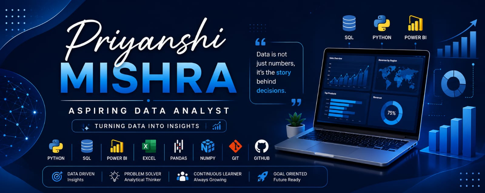

 

  

<h1 align="center">Hey there! 👋 I'm Priyanshi Mishra</h1>

<h3 align="center">Aspiring Data Analyst | Python Developer | AI Enthusiast 💜</h3>

  

  
  

---

## 💫 About Me

🎓 I'm a **BCA student at Shri Ramswaroop Memorial University**, passionate about data analytics, business intelligence, and artificial intelligence.

I enjoy exploring datasets, identifying meaningful patterns, and transforming raw data into actionable insights. I believe in learning by building practical projects and continuously improving my technical skills.

- 📊 Aspiring Data Analyst with a business-focused mindset
- 🐍 Working with Python, Pandas, SQL, and Excel
- 📈 Creating interactive dashboards using Power BI
- 🤖 Exploring AI applications in data analytics
- 🌱 Currently strengthening my SQL, visualization, and analytical skills
- 🤝 Open to internships, collaborative projects, and learning opportunities

---

## 🧰 Tech Stack & Tools

### 💻 Programming & Data Analysis

  

  
  
  
  
  
  

### 📊 Areas of Interest

`Data Cleaning` · `Exploratory Data Analysis` · `SQL Queries` · `Data Visualization` · `Dashboard Development` · `Business Intelligence` · `AI in Analytics`

---

## 🚀 Featured Projects

<table>
  <tr>
    <td width="50%">
      <h3 align="center">📊 Retail Business Performance Analysis</h3>
      
Analyzed retail sales, profit, product categories, and regional performance using Excel, SQL, Python, and Power BI.

      

        
      

    </td>
    <td width="50%">
      <h3 align="center">🤖 Customer Complaint & Service Analytics</h3>
      
Explored customer complaints, sentiment, ticket priorities, satisfaction, and resolution times using data analytics tools.

      

        
        
        
      

    </td>
  </tr>
  <tr>
    <td width="50%">
      <h3 align="center">📈 Exploratory Data Analysis</h3>
      
Investigated datasets, cleaned data, explored trends, and created visualizations to discover useful patterns.

    </td>
    <td width="50%">
      <h3 align="center">🗄️ SQL Sales Analysis</h3>
      
Practiced querying, filtering, aggregating, and analyzing sales data to generate business insights.

    </td>
  </tr>
  <tr>
    <td width="50%">
      <h3 align="center">🐍 ATM Management System</h3>
      
A Python project focused on basic ATM operations and transaction-related functionality.

    </td>
    <td width="50%">
      <h3 align="center">🧮 Python Calculator</h3>
      
A beginner-friendly Python application demonstrating basic arithmetic operations and programming fundamentals.

    </td>
  </tr>
</table>

  💡 Explore my repositories for project code, workflows, and future updates.

---

## 🏅 Certifications & Learning

- ☁️ **Google Cloud** — Introduction to Generative AI
- 🤖 **IBM** — AI Fundamentals
- 💼 **Microsoft Learn** — Enhance Your Productivity with Prebuilt Microsoft 365 Copilot Agents
- 📊 **Deloitte Australia / Forage** — Data Analytics & Data Visualization Job Simulations
- 🧠 **Forage** — Generative AI Powered Data Analyst Job Simulation
- 🎓 **NPTEL** — User-Centric Computing for Human-Computer Interaction (Elite)
- 🛰️ **ISRO / IIRS** — Remote Sensing Learning Programme

---

## 🌟 Achievements & Activities

- Built hands-on projects combining Excel, SQL, Python, and Power BI.
- Developed dashboards to communicate data-driven business insights.
- Continuously expanding my GitHub portfolio with practical projects.
- Sharing project work and learning milestones on LinkedIn.
- Participated in ICAT and the Microsoft Student Ambassador Learning Path.

---

## 📈 GitHub Overview

  
  

  

  

---

## 🤝 Let's Connect!

I'm always happy to connect with fellow learners, developers, and professionals interested in data, technology, and AI.

  
  

  <i>✨ Learning every day. Building with purpose. Growing through data.</i>

  ⭐ Thanks for visiting my profile! Feel free to explore my repositories.

